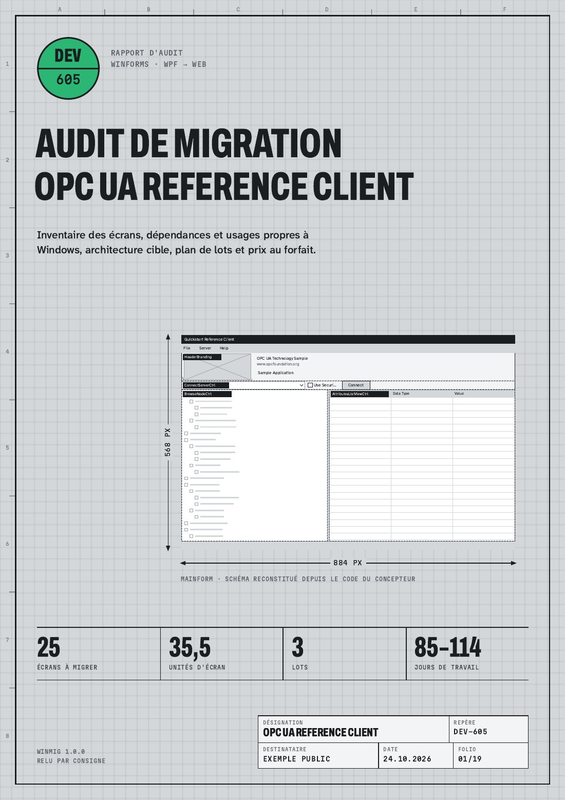

# winmig

**Inventaire et chiffrage d'une application .NET avant sa migration : vers .NET 10, et, pour WinForms ou WPF, vers le web.**

`winmig` lit le code source d'une solution .NET (C# ou VB.NET, .NET Framework 2.0 à .NET 10) sans le compiler ni l'exécuter, et produit en quelques secondes :

* l'**inventaire des écrans** : fenêtres, boîtes de dialogue, contrôles utilisateur, avec pour chacun ses contrôles, gestionnaires d'événements, liaisons de données, lignes de logique et une classe de complexité S, M, L ou XL ;
* le **schéma de chaque écran**, redessiné depuis le code du concepteur (WinForms : `InitializeComponent` et `.resx` ; WPF : XAML), y compris les ancrages, les onglets et les contrôles utilisateur imbriqués ;
* les **dépendances** (NuGet, assemblages, composants COM) classées par famille : suites DevExpress, Telerik, Infragistics, ComponentOne, Syncfusion, grilles, graphiques, protocoles industriels, matériel… avec leur équivalent côté web ;
* les **usages propres au poste Windows** (21 règles : registre, ports série, P/Invoke, COM, impression, fichiers locaux, protocoles industriels, `Invoke`/`Dispatcher`…), avec chaque emplacement dans le code ;
* le **périmètre réel** : seuls les écrans atteints depuis le point d'entrée (`Main`, `App.xaml`) sont chiffrés ; les autres sont listés à part ;
* les **rapports Crystal Reports** (`.rpt`) trouvés dans les projets, avec le code qui les ouvre : Crystal ne fonctionne pas sur .NET 5 et suivants, ils sont donc chiffrés à part, au forfait par rapport ;
* ce qui **bloque le passage à .NET 10**, projet par projet : cibles .NET 8 ou 9 (fin de support le 10 novembre 2026) et autres cibles hors support, exécution en 32 bits, composants COM et ActiveX, automatisation d'Office, Crystal Reports, pilotes SQL retirés (SQL Server Native Client, SQLOLEDB, Jet), envoi de mails en SMTP, WCF et Web Forms, avec ce qu'en fait GitHub Copilot app modernization ;
* un **plan de lots chiffré** : unités d'écran, jours, prix au forfait, et l'ordre dans lequel migrer.

Le tout dans un rapport A4 autonome (`rapport.html`, imprimable en PDF), en Markdown, en JSON et en CSV.

**Rapport d'exemple** sur l'application open source *OPC UA Reference Client* (OPC Foundation, licence MIT) : [exemples/opcua-reference-client/rapport.pdf](exemples/opcua-reference-client/rapport.pdf), 19 pages.



## Votre code ne quitte pas votre poste

* Analyse 100 % locale et hors ligne : `winmig` n'ouvre aucune connexion réseau, ne compile rien, n'exécute rien.
* Lecture seule : aucun fichier de votre dépôt n'est modifié ; tout est écrit dans le dossier de sortie.
* `inventaire.json` ne contient jamais de chemin absolu : seulement le nom du dossier analysé et des chemins relatifs à lui.
* `--sans-code` retire tous les extraits de code du rapport **et** de `inventaire.json`. Il reste des noms de classes, de contrôles et de méthodes, les libellés des écrans, des chemins relatifs, des numéros de ligne et des comptages.
* `--sans-libelles` retire en plus les textes des contrôles et les titres des fenêtres (les schémas montrent alors les noms des contrôles).

## Installation (moins de 10 minutes)

**Option 1 : exécutable Windows, rien à installer.** Téléchargez `winmig-1.0.0-win-x64.zip` dans les [versions publiées](https://github.com/Consigne-Studio/winmig/releases), décompressez, puis dans un terminal :

```powershell
.\winmig.exe analyser C:\sources\MonAppli\MonAppli.sln -o C:\temp\audit
```

Windows 10 ou Windows Server 2012 et plus récents, x64. Vérifiez l'archive avec l'empreinte publiée dans `SHA256SUMS.txt` (`Get-FileHash winmig-1.0.0-win-x64.zip`). L'exécutable n'est pas signé : si votre poste bloque les exécutables non signés, demandez à votre service informatique de l'autoriser d'après son empreinte, ou utilisez l'option 2.

**Option 2 : outil .NET depuis les sources** (SDK .NET 8 ou plus récent, `dotnet --version` pour vérifier ; avec un SDK 8.0.1xx, la compilation affiche des avertissements CS9057 sans conséquence, un SDK 8.0.4xx ou plus récent les évite).

```powershell
git clone https://github.com/Consigne-Studio/winmig; cd winmig
dotnet pack src/Winmig -c Release -o nupkg
dotnet tool install -g --add-source nupkg Consigne.Winmig
winmig analyser C:\sources\MonAppli\MonAppli.sln -o C:\temp\audit
```

Ouvrez ensuite `C:\temp\audit\rapport.html` dans votre navigateur. Pour un PDF : Ctrl+P, « Enregistrer au format PDF », marges « Aucune », graphismes d'arrière-plan cochés.

`winmig` fonctionne aussi sous Linux et macOS (les sources se lisent, elles ne sont pas compilées) : option 2, ou l'archive `linux-x64` des versions publiées.

## Utilisation

```text
winmig analyser <entrée> [-o <dossier>] [options]
winmig rapport <inventaire.json> [-o <dossier>] [options]
```

`<entrée>` est un dossier, une solution (`.sln`, `.slnx`) ou un projet (`.csproj`, `.vbproj`). Un projet est analysé avec tous les projets qu'il référence. Partez de la solution ou du projet exécutable : c'est lui qui donne le point d'entrée, donc le périmètre.

| Option | Effet |
|---|---|
| `-o, --sortie <dossier>` | Dossier de sortie (défaut : `./winmig-rapport`) |
| `--application <nom>` | Nom affiché de l'application |
| `--client <nom>` | Destinataire imprimé dans le cartouche |
| `--avis <fichier.md>` | Avis de l'auditeur, inséré en tête de la synthèse (Markdown simple) |
| `--auteur <nom>` | Nom de l'auditeur |
| `--date <AAAA-MM-JJ>` | Date du rapport |
| `--sans-code` | Aucun extrait de code, ni dans le rapport ni dans `inventaire.json` |
| `--sans-libelles` | Retire aussi les textes des contrôles et les titres des fenêtres |
| `--json-seul` | Écrit seulement `inventaire.json`, `ecrans.csv` et `constats.csv` |
| `--inclure <C1,C2>` | `rapport` seulement : ajoute ces écrans au périmètre |
| `--exclure <C1,C2>` | `rapport` seulement : retire ces écrans du périmètre |
| `-q`, `-h`, `-v` | Silencieux, aide, version |

La commande `rapport` refait le rapport complet (schémas compris) depuis un `inventaire.json`, sans le code source. C'est ainsi qu'un auditeur relit votre application à distance : vous lui envoyez `inventaire.json`, il ajoute son avis et corrige le périmètre.

Codes de retour : `0` succès, `1` aide affichée faute d'argument, `2` erreur d'usage, `3` entrée introuvable ou illisible.

### Exemples

```powershell
# Solution complète, rapport pour un comité de pilotage
winmig analyser .\Supervision.sln -o .\audit --application "Supervision ligne 3" --client "Direction industrielle"

# Inventaire à transmettre sans aucune ligne de code
winmig analyser .\Supervision.sln -o .\envoi --sans-code --json-seul

# Rapport refait depuis l'inventaire, avec un avis et un écran oublié remis dans le périmètre
winmig rapport .\envoi\inventaire.json -o .\livraison --avis .\avis.md --inclure ReglagesAvancesDlg
```

## Fichiers produits

| Fichier | Contenu |
|---|---|
| `rapport.html` | Rapport A4 autonome (polices incluses), à ouvrir dans un navigateur ou à imprimer |
| `rapport.md` | Même contenu, pour un wiki ou un ticket |
| `inventaire.json` | Toutes les mesures, réutilisables par vos outils (et par `winmig rapport`) |
| `ecrans.csv`, `constats.csv` | Pour Excel (séparateur point-virgule, UTF-8) |
| `schemas/*.svg` | Le schéma de chaque écran |

## Comment le chiffrage est calculé

Chaque écran reçoit un score : contrôles + 2 × événements + liaisons + lignes de logique ÷ 15 + 0,5 × branches + 4 × contrôles tiers. Le score donne une classe et des **unités d'écran** : S = 0,5 · M = 1 · L = 2 · XL = 3, plus 0,5 par point lourd propre à l'écran (accès direct à une base, dessin personnalisé, animation). S'y ajoutent un socle (4 unités : application, authentification, thème, temps réel, intégration continue) et des chantiers transverses (registre, COM, protocole industriel…) dont le coût croît avec le nombre de fichiers touchés. Une unité vaut 2,4 à 3,2 jours de travail ; les jours d'un lot sont ses unités multipliées par ces deux bornes. Le détail est imprimé à la fin de chaque rapport, page « Méthode et limites » ; la méthode complète est dans [docs/methode.md](docs/methode.md).

Ce chiffrage est **indicatif** : il mesure le code, pas votre organisation. Il sert à comparer des options et à ouvrir la discussion, pas à signer un devis sans relecture.

## Ce que l'outil ne voit pas

* Les écrans créés par réflexion ou par configuration, et les contrôles créés dynamiquement à l'exécution.
* La logique cachée dans la base de données (procédures stockées, déclencheurs).
* La disposition finale quand le code la modifie à l'exécution : les schémas montrent l'état du concepteur.
* Les écrans WPF construits entièrement en code (sans XAML) : comptés, mais sans schéma.

## Problèmes fréquents

| Symptôme | Cause et solution |
|---|---|
| `Entrée non reconnue` | Donnez un `.sln`, `.slnx`, `.csproj`, `.vbproj` ou un dossier, pas un fichier `.cs`. |
| Aucun écran trouvé | Vérifiez que l'entrée contient bien les projets d'interface ; partez de la solution plutôt que d'un projet de bibliothèque. |
| Beaucoup d'écrans « hors périmètre » | Normal pour une bibliothèque partagée : seuls les écrans appelés depuis l'exécutable sont chiffrés. Remettez-en avec `winmig rapport … --inclure`. |
| Projet ignoré (avertissement) | Projet introuvable sur le disque ou dans un format non MSBuild (C++/CLI, `.vdproj`). Il est listé en fin d'analyse. |
| `dotnet` introuvable | Utilisez l'exécutable Windows (option 1), ou installez le SDK .NET 8 depuis le site de Microsoft. |
| Le PDF imprimé a des marges blanches | Dans la boîte d'impression : marges « Aucune » et « Graphismes d'arrière-plan » cochés. |

## FAQ

**Faut-il Visual Studio, les paquets NuGet restaurés ou une compilation qui passe ?** Non. `winmig` lit les fichiers tels quels. Un projet qui ne compile plus s'analyse quand même.

**Quelles versions ?** WinForms et WPF, C# et VB.NET, projets au format SDK ou ancien format (`packages.config`), .NET Framework 2.0 à 4.8.1 et .NET Core 3.1 à .NET 10 (WinForms et WPF existent sur .NET depuis .NET Core 3.0).

**Combien de temps ?** Quelques secondes : 8 s pour le dépôt complet des exemples OPC UA (68 projets, 142 000 lignes), 6 s pour les 253 projets des exemples WPF de Microsoft.

**Puis-je l'utiliser en intégration continue ?** Oui : `--json-seul` et les codes de retour sont faits pour ça. Licence MIT.

**Et ensuite ?** Le rapport dit quoi migrer, dans quel ordre et pour quel ordre de prix. Si vous voulez qu'un développeur senior le relise, rédige l'avis, valide le périmètre avec vous et maquette deux écrans en web, c'est l'**audit de migration à prix fixe** (4 900 € HT, 10 jours ouvrés, 100 % à distance), puis la migration **au forfait, lot par lot**. Pour une solution déjà en .NET 8 ou 9, le **passage à .NET 10** est un forfait de 490 à 1 490 € HT. Toutes les offres : [migration-dotnet.pages.dev](https://migration-dotnet.pages.dev/#forfaits).

## Construire depuis les sources

```bash
cd src
dotnet test                                  # 52 tests
dotnet pack Winmig -c Release -o ../nupkg    # outil .NET
dotnet publish Winmig -c Release -r win-x64 --self-contained -p:PublishSingleFile=true \
  -p:EnableCompressionInSingleFile=true -p:DebugType=none -p:PackAsTool=false -o ../dist/win-x64
```

Comparer le PDF d'un état migré à son PDF de référence (Crystal Reports ou autre) : `node scripts/comparer-pdf.mjs reference.pdf nouveau.pdf -o comparaison` (Poppler requis : `pdfinfo`, `pdftoppm`, `pdftotext`). Il rend les pages une par une, compare le nombre de pages, le texte de chaque page mot à mot (hors mise en page) et les pixels, écrit `comparaison.html` avec les lignes présentes d'un seul côté et la carte des écarts (20 premières pages à valider), et sort avec le code 0 si tout est conforme, 1 s'il y a un écart, 2 en cas d'erreur d'usage. Exemple : [exemples/comparaison-pdf](exemples/comparaison-pdf/README.md).

PDF d'un rapport sans passer par le navigateur : `npm install`, `npx playwright install chromium`, puis `node scripts/pdf.mjs <dossier du rapport>`. Le script signale toute page dont le contenu serait coupé.

## Licence et contact

Code sous licence MIT (voir [LICENSE](LICENSE)). Polices Archivo, Martian Mono et Atkinson Hyperlegible Next intégrées au rapport sous licence SIL Open Font License 1.1 (voir [src/Winmig.Core/polices/OFL.txt](src/Winmig.Core/polices/OFL.txt)). Composants tiers inclus dans les exécutables : voir [THIRD-PARTY-NOTICES.txt](THIRD-PARTY-NOTICES.txt). WinForms, WPF, Visual Studio et .NET sont des marques de Microsoft ; ce projet n'est ni affilié ni approuvé par Microsoft.

Une question, un écran mal lu : support@consignestudio.fr. Joignez si possible `inventaire.json` produit avec `--sans-code`.
